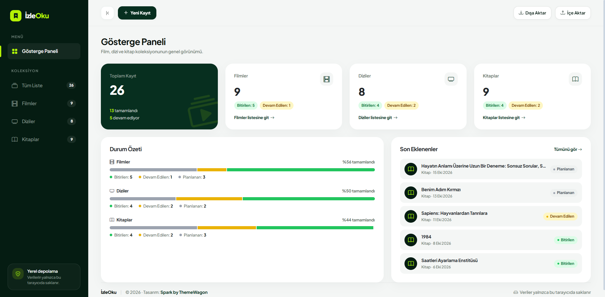

# İzleOku · Film, Dizi ve Kitap Takip Sistemi

İzleOku; izlemek istediğin filmleri ve dizileri, okumak istediğin kitapları tek bir yerde takip etmeni sağlayan bir web uygulamasıdır. Her kaydın durumunu (Planlanan, Devam Edilen, Bitirilen) işaretleyebilir, puan verebilir ve not ekleyebilirsin.

Bu proje bir eğitim ödevi olarak geliştirilmiştir. Amaç; React ve TypeScript ile bileşen tabanlı bir arayüz kurmak, CRUD işlemlerini uygulamak ve veri erişimini ayrı bir katmanda toplamaktır.

## Ekran görüntüsü

> _Ekran görüntüsü buraya eklenecek._

Örnek: 

## Özellikler

- **Kayıt ekleme:** Modal form ile yeni film, dizi veya kitap ekleme. Başlık ve tür zorunludur, durum varsayılan olarak "Planlanan" (`planned`) gelir. Hatalı alanlar için form içinde uyarı mesajları gösterilir.
- **Listeleme:** Kayıtlar tablo veya kart görünümünde listelenir. Tür ve durum rozetlerle gösterilir (planlandı: gri, devam ediyor: sarı, tamamlandı: yeşil).
- **Güncelleme:** Kaydı düzenleme formu. Ayrıca listeden hızlı durum değiştirme: tabloda açılır menü, kart görünümünde buton grubu.
- **Silme:** Silmeden önce onay penceresi gösterilir.
- **Filtreleme ve arama:** Türe göre (Tümü / Film / Dizi / Kitap), duruma göre ve başlıkta arama. Sıralama seçenekleri: en yeni, en eski, başlık, puan.
- **Gösterge Paneli:** Toplam kayıt sayısı, tür bazlı özet kartları, her tür için durum dağılımı ("Bitirilen: 5" gibi) ve son eklenen kayıtlar.
- **Boş durum mesajları:** Liste boşsa veya filtreye uyan kayıt yoksa bilgilendirici mesaj gösterilir.
- **Yedekleme:** Tüm veriyi JSON dosyası olarak dışa aktarma ve JSON dosyasından içe aktarma. İçe aktarmadan önce dosya doğrulanır ve onay istenir.
- **Durum etiketleri:** Tüm türler için ortak: "Planlanan / Devam Edilen / Bitirilen".
- **Mobil uyum:** Küçük ekranlarda yan menü gizlenir ve menü düğmesiyle açılır. Geniş ekranlarda yan menü daraltılabilir.

## Kullanılan teknolojiler

- [React 19](https://react.dev/)
- [TypeScript](https://www.typescriptlang.org/)
- [Vite 8](https://vite.dev/) (geliştirme sunucusu ve derleme)
- [Bootstrap 5](https://getbootstrap.com/) ve [Bootstrap Icons](https://icons.getbootstrap.com/)
- Tarayıcının `localStorage` API'si (veri saklama)

Ek bir yönlendirme (router) kütüphanesi kullanılmamıştır. Sayfa geçişleri React state'i ile yapılır; bu state URL hash'i (`#/filmler` gibi) ile senkron tutulur. Böylece sayfa yenilendiğinde ve tarayıcının geri/ileri tuşları kullanıldığında doğru sayfa açılır.

## Klasör yapısı

```
src/
├── assets/vendor/     # Spark şablonundan alınan Bootstrap Icons yazı tipi
├── components/        # Tekrar kullanılan bileşenler
│   ├── Sidebar, Topbar, Footer, Logo, PageHeader
│   ├── ItemTable, ItemCard, ItemFilters, ItemForm
│   ├── StatusBadge, TypeBadge, StatusSelect, StatusToggle
│   ├── RatingStars, RatingInput, EmptyState
│   ├── Modal, ConfirmModal, ToastMessage
│   └── StatsCards, StatusSummary, RecentItems
├── interfaces/        # TypeScript tipleri (TrackedItem, ItemType, ItemStatus, Route...)
├── pages/             # Sayfa bileşenleri: Gösterge Paneli, ItemList, NotFound
├── services/          # Veri katmanı
│   ├── itemService.ts   # localStorage CRUD: getAll, getById, add, update, remove, replaceAll
│   └── backupService.ts # JSON dışa/içe aktarma
├── utils/             # Yardımcı fonksiyonlar
│   ├── labels.ts        # Tür/durum etiketleri (getStatusLabel)
│   ├── validation.ts    # Form ve veri doğrulama
│   ├── itemFilters.ts   # Filtreleme ve sıralama
│   ├── stats.ts         # Gösterge Paneli istatistikleri
│   ├── navigation.ts    # State tabanlı sayfa geçişi
│   └── format.ts        # Tarih biçimlendirme
├── App.tsx            # Uygulama durumu, CRUD işleyicileri ve modallar
├── main.tsx           # Giriş noktası
└── index.css          # Spark'tan uyarlanan stiller
```

**Önemli kural:** `localStorage`'a yalnızca `services/itemService.ts` erişir. Bileşenler veriyi her zaman bu servis üzerinden okur ve yazar. İleride gerçek bir veritabanına geçildiğinde yalnızca servis dosyasının içi değiştirilir.

## Kurulum ve çalıştırma

Gereksinim: [Node.js](https://nodejs.org/) 20.19+ veya 22.12+

```bash
# Bağımlılıkları yükle
npm install

# Geliştirme sunucusunu başlat (varsayılan: http://localhost:5173)
npm run dev

# Üretim için derle (çıktı: dist/)
npm run build

# Derlenmiş sürümü yerelde önizle
npm run preview
```

### Netlify'da yayınlama

Proje kökündeki `netlify.toml` dosyası hazırdır:

- Derleme komutu: `npm run build`
- Yayın klasörü: `dist`
- Tek sayfa uygulaması için tüm yollar `index.html`'e yönlendirilir.

## Veriler nerede saklanıyor?

Tüm veriler **yalnızca kullandığın tarayıcının `localStorage` alanında** saklanır (`izleoku:items` anahtarı altında, JSON olarak). Bu nedenle:

- Sunucuya veri gönderilmez ve giriş/kayıt gerekmez.
- Veriler başka bir tarayıcıya veya cihaza kendiliğinden taşınmaz.
- Tarayıcı verilerini temizlersen kayıtların da silinir. Düzenli olarak **Dışa Aktar** ile yedek almanı öneririz.
- Kayıtlı veri bozulursa uygulama çökmez, boş bir listeyle açılır.

## Tasarım ve atıf

Arayüz, ThemeWagon tarafından dağıtılan ücretsiz **[Spark](https://themewagon.com/themes/spark/)** Bootstrap 5 şablonu görsel referans alınarak hazırlanmıştır. Şablon MIT lisanslıdır; tasarım ve kod telif hakkı [Spark Admin Dev](https://sparkadminpro.gumroad.com/) ekibine aittir. Yan menü, üst bar, kart, tablo ve form stilleri React bileşenlerine uyarlanmış, kullanılmayan bölümler (giriş sayfaları, grafikler, örnek veriler) projeye alınmamıştır.

**Tasarım: Spark by ThemeWagon**

## Gelecek planları

- **Kullanıcı girişi:** Hesap oluşturma ve giriş yapma; her kullanıcının kendi listesi.
- **Bulut veritabanı:** Verilerin bir bulut veritabanında saklanması ve cihazlar arasında senkronizasyon. Veri erişimi `services` katmanında toplandığı için bu geçişte yalnızca servis dosyası değişecek.
- Kapak görseli ekleme, etiketler ve izleme/okuma tarihleri gibi ek alanlar.
